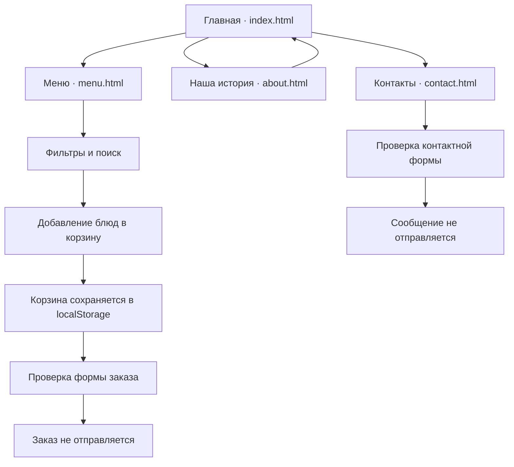

# Печь & Искра — сайт-визитка пиццерии

Учебный многостраничный сайт на чистых HTML, CSS и JavaScript по заданию о статическом сайте-визитке.

> **Важно:** «Печь & Искра» — вымышленная концепция для учебной работы. Меню, цены, часы и контактные сведения демонстрационные. Заказы и сообщения не отправляются.

## Страницы

| Страница | Назначение |
|---|---|
| [Главная](index.html) | Идея пиццерии, преимущества и популярные блюда |
| [Меню](menu.html) | Карточки блюд, поиск по ингредиентам, фильтры и корзина |
| [Наша история](about.html) | История бренда и принципы приготовления |
| [Контакты](contact.html) | Пример контактного блока и демонстрационная форма |

## Функциональность

| Функция | Описание |
|---|---|
| Адаптивный дизайн | Макет подстраивается под телефон, планшет и настольный экран |
| Общая навигация | Единая шапка и подвал на всех страницах |
| Переключение темы | Светлая и тёмная темы с сохранением выбора в localStorage |
| Фильтрация меню | Категории блюд и поиск по названию или ингредиентам |
| Корзина | Добавление, удаление и изменение количества с сохранением в localStorage |
| Формы | Проверка обязательных полей; отправка не выполняется |
| Доступность | Семантическая разметка, подписи кнопок, видимый клавиатурный фокус и reduced-motion |

## Схема работы сайта

## Структура файлов

| Путь | Назначение |
|---|---|
| index.html | Главная страница |
| menu.html | Меню и демонстрационная корзина |
| about.html | О концепции пиццерии |
| contact.html | Контакты и демонстрационная форма |
| css/style.css | Палитра, компоненты и адаптивные стили |
| js/script.js | Корзина, фильтры, темы и обработка форм |
| img/logo.svg | Векторный логотип |
| img/pizza.svg | Векторная иллюстрация пиццы (резервный декоративный ресурс) |
| images/hero-pizza.webp | Главное фото на главной странице |
| images/margherita.webp | Фото пиццы Маргарита |
| images/pepperoni.webp | Фото пиццы Пепперони |
| images/mushroom.webp | Фото грибной пиццы |
| images/four-cheese.webp | Фото пиццы Четыре сыра |
| images/lemonade.webp | Фото напитка Добрый Кола |
| images/americano.webp | Фото Американо |
| favicon.svg | Иконка сайта |

## Технологии

HTML5, CSS3, JavaScript, Git, GitHub Pages и localStorage. Внешние библиотеки для логики сайта не требуются.

## Локальный запуск

Откройте index.html в браузере или используйте Live Server в Visual Studio Code. Установка npm-пакетов и сборка не нужны.

## Публикация на GitHub Pages

1. Откройте **Settings → Pages** в этом репозитории.
2. Выберите **Deploy from a branch**.
3. Укажите ветку **main** и папку **/(root)**, затем сохраните настройки.
4. После публикации сайт будет доступен по адресу:

   https://notsons-git.github.io/my-web-site/

## Связанные учебные материалы

| Ресурс | Для чего |
|---|---|
| [Учебный репозиторий notsons](https://github.com/notsons-git/test) | Конспекты, Bash-практика, Markdown и Git |
| [Дело Красного Джона](https://github.com/notsons-git/my-site) | Отдельный эксперимент с визуальным дизайном |
| [Профиль автора](https://github.com/notsons-git) | Другие работы и учебные проекты |

## Авторство

Учебный концепт notsons. Все сведения о заведении демонстрационные.